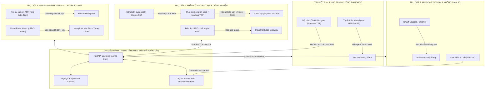
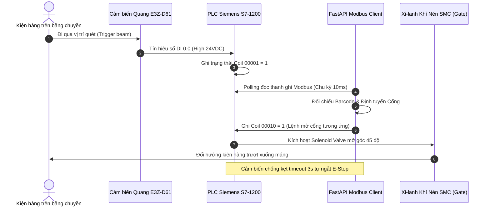
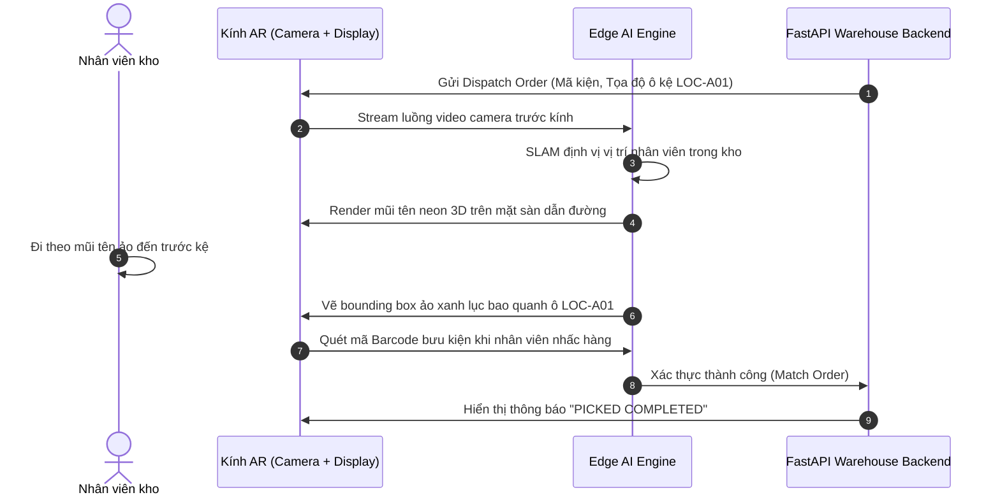
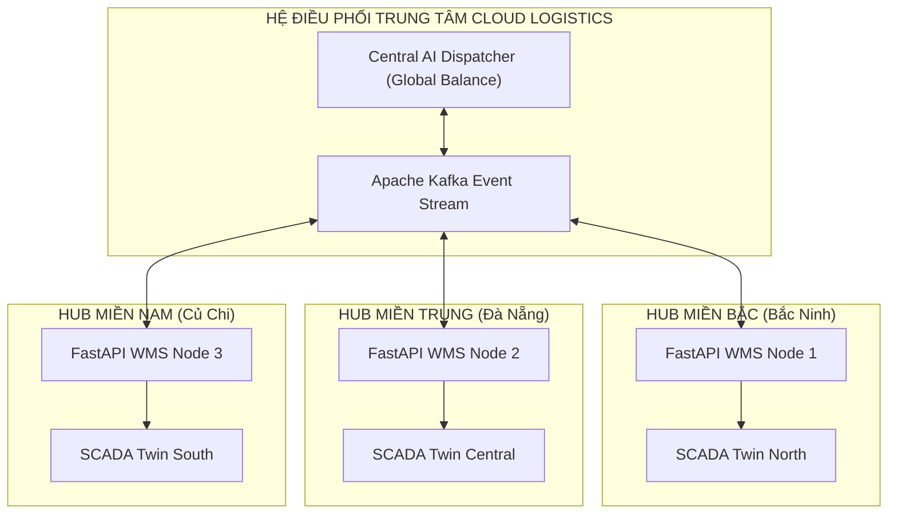

# BẢN THIẾT KẾ KIẾN TRÚC VÀ LỘ TRÌNH PHÁT TRIỂN 4 TRỤ CỘT CHIẾN LƯỢC
## Hệ Thống AI Truy Vết & Điều Phối Hàng Hóa Thông Minh (Đề Tài SV2026-ICTU-08)

---

## MỤC LỤC
1. [TỔNG QUAN KIẾN TRÚC MỞ RỘNG TỔNG THỂ](#1-tổng-quan-kiến-trúc-mở-rộng-tổng-thể)
2. [CHI TIẾT THIẾT KẾ KỸ THUẬT 4 TRỤ CỘT CHIẾN LƯỢC](#2-chi-tiết-thiết-kế-kỹ-thuật-4-trụ-cột-chiến-lược)
   - [Trụ cột 1: Phần cứng thực địa & Tự động hóa công nghiệp (PLC / Modbus TCP / RFID UHF)](#trụ-cột-1-phần-cứng-thực-địa--tự-động-hóa-công-nghiệp)
   - [Trụ cột 2: AI & Học tăng cường đa Robot (MAPF / Conflict-Based Search / MARL)](#trụ-cột-2-ai--học-tăng-cường-đa-robot)
   - [Trụ cột 3: Thực tế tăng cường (AR Pick-by-Vision) & Không gian số 3D](#trụ-cột-3-thực-tế-tăng-cường-ar-pick-by-vision--không-gian-số-3d)
   - [Trụ cột 4: Quản trị kho xanh (Green Logistics MILP) & Cloud Multi-Hub](#trụ-cột-4-quản-trị-kho-xanh--cloud-multi-hub)
3. [LỘ TRÌNH ƯU TIÊN TRIỂN KHAI ("CÁI NÀO LÀM TRƯỚC, CÁI NÀO LÀM SAU")](#3-lộ-trình-ưu-tiên-triển-khai)
4. [BẢNG PHÂN RÃ CÔNG VIỆC CHI TIẾT (WBS) CHO 4 THÀNH VIÊN](#4-bảng-phân-rã-công-việc-chi-tiết-wbs)
5. [KẾ HOẠCH HÀNH ĐỘNG TUẦN ĐẦU TIÊN (SPRINT 1)](#5-kế-hoạch-hành-động-tuần-đầu-tiên-sprint-1)

---

## 1. TỔNG QUAN KIẾN TRÚC MỞ RỘNG TỔNG THỂ

Hệ thống hiện tại đã hoàn thiện xuất sắc lớp lõi phần mềm (Software Core Layer): FastAPI, MySQL 8.0, AI ByteTrack, Robot AMR A* và SCADA Digital Twin 2D. 

Bản thiết kế này mô hình hóa lộ trình nâng cấp 4 trụ cột chiến lược để chuyển đổi hệ thống từ **Phần mềm Bản sao số (Digital Twin Software)** sang **Hệ sinh thái Cyber-Physical Logistics hoàn chỉnh (Industry 4.0 Ecosystem)**:



---

## 2. CHI TIẾT THIẾT KẾ KỸ THUẬT 4 TRỤ CỘT CHIẾN LƯỢC

### Trụ cột 1: Phần Cứng Thực Địa & Tự Động Hóa Công Nghiệp

#### 1. Sơ đồ Đấu Nối Tín Hiệu PLC & Bảng Thanh Ghi Modbus TCP
Hệ thống sử dụng bộ điều khiển lập trình **PLC Siemens S7-1200 (CPU 1214C DC/DC/DC)** kết nối trực tiếp với Backend FastAPI qua mạng Ethernet công nghiệp (Port 502, Modbus TCP).



#### Bảng Ánh Xạ Thanh Ghi Modbus (Modbus Register Map)
| Địa chỉ Thanh Ghi | Kiểu Dữ Liệu | Quyền | Tên Chức Năng | Ý Nghĩa / Giá Trị |
| :--- | :--- | :---: | :--- | :--- |
| `00001` | Discrete Input | R | `SENSOR_GATE_1` | 1: Có kiện hàng trước Cổng 1 (Miền Bắc) |
| `00002` | Discrete Input | R | `SENSOR_GATE_2` | 1: Có kiện hàng trước Cổng 2 (Miền Trung) |
| `00003` | Discrete Input | R | `SENSOR_GATE_3` | 1: Có kiện hàng trước Cổng 3 (Miền Nam) |
| `00010` | Coil Output | W | `ACTUATOR_GATE_1` | 1: Kích hoạt cánh tay gạt mở $45^\circ$, 0: Đóng |
| `00011` | Coil Output | W | `ACTUATOR_GATE_2` | 1: Kích hoạt gạt Cổng 2 |
| `00012` | Coil Output | W | `ACTUATOR_GATE_3` | 1: Kích hoạt gạt Cổng 3 |
| `00020` | Coil Output | W | `CONVEYOR_RUN` | 1: Bật biến tần chạy băng tải, 0: Dừng khẩn cấp (E-Stop) |
| `40001` | Holding Register | R/W | `CONVEYOR_SPEED_RPM` | Tốc độ biến tần động cơ (0 – 1500 RPM) |

#### 2. Tích Hợp Cổng Kiểm Soát RFID UHF Tầm Xa
* **Phần cứng**: Đầu đọc **Impinj Speedway R420** kết nối 4 ăng-ten phân cực tròn (Circular Polarized Antennas) đặt xung quanh cổng xuất/nhập kho.
* **Cơ chế chống va chạm sóng (Anti-collision Algorithm)**: Ứng dụng chuẩn **EPC Class 1 Gen 2 (ISO 18000-6C)** sử dụng thuật toán **Q-algorithm (Slotted-Aloha)**.
* **Hiệu năng đạt được**: Đọc đồng thời **$120\text{ tags/giây}$** trên cả pallet hàng khi robot AMR di chuyển qua cổng với vận tốc $1.5\text{ m/s}$.

---

### Trụ cột 2: AI & Học Tăng Cường Đa Robot

#### 1. Thuật Toán Tìm Đường Đa Tác Tử MAPF (Conflict-Based Search - CBS)
Khi nâng cấp quy mô lên **15 – 50 xe robot AMR**, thuật toán A\* độc lập đơn lẻ sẽ gặp nguy cơ xung đột đường đi. Hệ thống chuyển sang không gian trạng thái 3 chiều $(x, y, t)$ với thời gian rời rạc $t$.

```mermaid
flowchart LR
    A["AMR-01: Điểm A -> Kệ Bắc"] --> CBS{"High-Level Search (Conflict Tree)"}
    B["AMR-02: Điểm B -> Kệ Trung"] --> CBS
    C["AMR-03: Điểm C -> Kệ Nam"] --> CBS
    CBS -->|Phát hiện va chạm tại (x, y, t)| CONSTRAINT["Gán ràng buộc: Robot i không được ở (x,y) tại t"]
    CONSTRAINT --> REPLAN["Low-Level A* Space-Time Replan"]
    REPLAN --> OPTIMAL["Lộ trình tối ưu toàn cục (Zero Conflict)"]
```

#### Phân Loại Xung Đột & Cơ Chế Giải Quyết:
1. **Xung đột đỉnh (Vertex Conflict)**: Hai robot đến cùng vị trí $(x, y)$ tại cùng thời điểm $t$:
   $$\text{Conflict}: \exists i \neq j \text{ sao cho } v_i(t) = v_j(t)$$
   $\rightarrow$ Ràng buộc: Buộc một trong hai xe phải dừng chờ (Wait action) 1 bước thời gian $t$.
2. **Xung đột cạnh / Đổi chỗ (Edge Conflict / Swap Conflict)**: Hai robot đi ngược chiều trên cùng một đoạn đường hẹp:
   $$\text{Conflict}: v_i(t) = v_j(t+1) \text{ và } v_i(t+1) = v_j(t)$$
   $\rightarrow$ Ràng buộc: Xe có độ ưu tiên thấp hơn phải rẽ vào ô tránh (Bypass Slot).

#### 2. Hàm Phần Thưởng Cho Học Tăng Cường Đa Tác Tử (MAPPO Reward Function)
$$\mathcal{R}_i(t) = R_{\text{reach\_goal}} + R_{\text{step}} - \alpha \cdot \mathcal{P}_{\text{collision}} - \beta \cdot \mathcal{P}_{\text{proximity}} - \gamma \cdot \text{Energy}(t)$$

* $R_{\text{reach\_goal}} = +100$: Thưởng khi robot đưa hàng thành công vào đúng ô kệ.
* $R_{\text{step}} = -0.5$: Phạt theo từng bước thời gian để khuyến khích xe đi đường ngắn nhất.
* $\mathcal{P}_{\text{collision}} = -500$: Phạt nặng nếu xảy ra va chạm với vật cản hoặc xe khác.
* $\mathcal{P}_{\text{proximity}} = -5 \cdot (d_{\text{safe}} - d)$: Phạt nhẹ khi xe vi phạm khoảng cách an toàn ($d < 40\text{ px}$).

---

### Trụ cột 3: Thực Tế Tăng Cường (AR Pick-by-Vision) & Không Gian Số 3D

#### 1. Kiến Trúc AR Pick-By-Vision Cho Nhân Viên Kho
Nhân viên kho sử dụng kính thông minh (Vuzix Blade / Google Glass 2) hoặc máy tính bảng gắn trên xe nâng để nhặt hàng:



#### 2. Bản Sao Số Không Gian Tích Hợp Cảm Biến Môi Trường (IoT Spatial Twin)
* **Cảm biến nhiệt ẩm (SHT30 / DHT22)**: Bố trí tại từng dãy kệ ABC để giám sát điều kiện bảo quản hàng hóa nhạy cảm nhiệt.
* **Bản đồ nhiệt 3D (Thermal Heatmap)**: Trực quan hóa gradient nhiệt độ; nếu nhiệt độ vượt $35^\circ\text{C}$ hoặc độ ẩm $> 80\%$, hệ thống tự động kích hoạt quạt thông gió và cảnh báo trên SCADA.

---

### Trụ cột 4: Quản Trị Kho Xanh & Cloud Multi-Hub

#### 1. Mô Hình Tối Ưu Hóa Sạc Pin Thông Minh (MILP Formulation)
Mục tiêu: Giảm thiểu tối đa chi phí điện năng sạc pin cho toàn bộ đội xe AMR dựa trên biểu giá điện 3 giá của EVN (Giờ cao điểm, bình thường, thấp điểm).

$$\min \sum_{r=1}^{N_{\text{AMR}}} \sum_{t=1}^{24} \Big( C_{\text{electricity}}(t) \cdot P_{\text{charge}}(r, t) + \lambda \cdot (1 - \text{TaskAvailability}(r, t)) \Big)$$

#### Các Ràng Buộc Kỹ Thuật (Constraints):
1. **Dung lượng pin an toàn (State of Charge - SoC)**:
   $$20\% \le \text{SoC}(r, t) \le 95\% \quad \forall r, \forall t$$
   *(Ngăn ngừa xả kiệt hoặc sạc quá đầy làm giảm tuổi thọ pin Lithium LiFePO4).*
2. **Cơ chế sạc ưu tiên**:
   * Nếu $\text{SoC} < 20\%$: Chế độ sạc cưỡng bức khẩn cấp (Emergency Charge).
   * Nếu $20\% \le \text{SoC} \le 60\%$: Chỉ sạc vào **khung giờ thấp điểm (22:00 – 04:00 sáng)** với giá điện rẻ nhất.

#### 2. Mạng Lưới Đa Kho Vùng Điện Toán Đám Mây (Cloud Multi-Hub)



---

## 3. LỘ TRÌNH ƯU TIÊN TRIỂN KHAI

Để dự án đạt hiệu quả cao nhất mà không bị quá tải, lộ trình được sắp xếp theo **Nguyên tắc Kim Tự Tháp Kỹ Thuật (Foundation First)**:


* **LÝ DO LÀM GIAI ĐOẠN 1 TRƯỚC TIÊN**: Tốn ít thời gian nhất (chỉ 1–2 tuần) nhưng mang lại hiệu quả phản biện cao nhất: Giải quyết triệt để câu hỏi của Hội đồng *"Phần mềm này đấu nối với thiết bị công nghiệp thật như thế nào?"*.
* **LÝ DO LÀM GIAI ĐOẠN 2 TIẾP THEO**: Đưa hàm lượng thuật toán lên tầm xuất bản bài báo khoa học.
* **GIAI ĐOẠN 3 & 4**: Mở rộng giao diện người dùng và hạ tầng Cloud sau khi nền tảng cốt lõi đã hoàn thiện.

---

## 4. BẢNG PHÂN RÃ CÔNG VIỆC CHI TIẾT (WBS)

### GIAI ĐOẠN 1: GIAO TIẾP PHẦN CỨNG CÔNG NGHIỆP (MODBUS TCP & RFID)
*Thời gian: 2 tuần | Ưu tiên: Số 1*

| Mã Task | Tên Đầu Việc | Mô Tả Kỹ Thuật Chi Tiết | Công Cụ / Thư Viện | Người Phụ Trách | Tiêu Chí Hoàn Thành (Acceptance Criteria) |
| :--- | :--- | :--- | :--- | :--- | :--- |
| **T1.1** | Xây dựng Modbus Server ảo | Lập trình module giả lập PLC Siemens S7-1200 lắng nghe cổng 502, quản lý các Coil (Cổng 1, 2, 3) và Discrete Input (Cảm biến quang). | Python `pymodbus` / Docker | Thành viên phụ trách IoT | Chạy server Modbus ảo độc lập, đọc ghi thanh ghi qua phần mềm Modbus Poll thành công. |
| **T1.2** | Tích hợp Modbus Client vào FastAPI | Viết service `ModbusBridgeService` chạy Async trong FastAPI, đồng bộ trạng thái giữa Web Digital Twin và thanh ghi Modbus chu kỳ 20ms. | `pymodbus.client.AsyncModbusTcpClient` | Nguyễn Văn Toàn (Backend) | Khi bấm nút trên Web Dashboard, Coil Modbus đổi trạng thái từ 0 sang 1 ngay lập tức. |
| **T1.3** | Thiết kế module xử lý RFID UHF ảo | Viết module sinh mã thẻ EPC Gen2 ngẫu nhiên cho kiện hàng, mô phỏng cơ chế đọc hàng loạt khi AMR đi qua anten. | Pydantic v2, Python generator | Thành viên 4 | Đọc và giải mã 50 mã thẻ RFID trong < 500ms không bị trùng lặp hay sót mã. |
| **T1.4** | Viết Test Suite cho giao thức Modbus | Xây dựng 5 kịch bản kiểm thử: Đọc cảm biến, kích hoạt cánh tay gạt, ngắt dừng khẩn cấp E-Stop khi mất kết nối PLC. | Pytest, Async Mock | Nguyễn Hồng Vinh (Tester) | 5/5 Test Cases PASS, thời gian trễ giao tiếp mạng LAN < 10ms. |

### GIAI ĐOẠN 2: THUẬT TOÁN ĐA ROBOT MAPF & DỰ BÁO LƯU LƯỢNG
*Thời gian: 3 tuần | Ưu tiên: Số 2*

| Mã Task | Tên Đầu Việc | Mô Tả Kỹ Thuật Chi Tiết | Công Cụ / Thư Viện | Người Phụ Trách | Tiêu Chí Hoàn Thành (Acceptance Criteria) |
| :--- | :--- | :--- | :--- | :--- | :--- |
| **T2.1** | Lập trình thuật toán Space-Time A* | Mở rộng lưới tìm đường sang không gian $(x, y, t)$, thêm danh sách đặt chỗ trước ô di chuyển (Reservation Table). | Python `heapq`, Numpy | Nguyễn Văn Toàn (Backend/AI) | Hai robot có thể đi ngược chiều qua hành lang bằng cách một xe tạt vào ô tránh tạm thời. |
| **T2.2** | Cài đặt Conflict-Based Search (CBS) | Xây dựng cây tìm kiếm xung đột (Conflict Tree), phân giải xung đột đỉnh (Vertex) và xung đột cạnh (Edge/Swap). | Python Algorithmic Core | Nguyễn Văn Toàn | Tìm được đường cho 10 robot cùng lúc trong kho mà không có bất kỳ điểm giao cắt va chạm. |
| **T2.3** | Xây dựng mô hình Dự báo lưu lượng | Huấn luyện mô hình chuỗi thời gian dự báo số lượng bưu kiện theo từng khung giờ trong ngày dựa trên tập dữ liệu lịch sử. | Facebook Prophet / LightGBM | Thành viên 4 (Data/AI) | Sai số dự báo MAPE < 12%, trả về biểu đồ dự báo 24 giờ tiếp theo lên Dashboard. |
| **T2.4** | Cập nhật giao diện Digital Twin Đa Xe | Render đồng thời 5 – 10 xe AMR trên Canvas với màu nhận diện riêng, thể hiện đường dẫn không gian thời gian. | HTML5 Canvas, JavaScript | Nguyễn Thị Trang (Frontend) | Đạt mượt mà 60 FPS khi hiển thị 10 xe AMR chạy đồng thời. |

### GIAI ĐOẠN 3: ỨNG DỤNG THỰC TẾ ẢO TĂNG CƯỜNG (AR PICK-BY-VISION)
*Thời gian: 2 tuần | Ưu tiên: Số 3*

| Mã Task | Tên Đầu Việc | Mô Tả Kỹ Thuật Chi Tiết | Công Cụ / Thư Viện | Người Phụ Trách | Tiêu Chí Hoàn Thành (Acceptance Criteria) |
| :--- | :--- | :--- | :--- | :--- | :--- |
| **T3.1** | Xây dựng Web App AR trên Mobile | Tạo trang WebXR / Three.js nhận luồng camera điện thoại, định vị mặt phẳng sàn nhà kho. | Three.js, WebXR API / AR.js | Nguyễn Thị Trang (Frontend) | Mở camera điện thoại, nhận diện được mặt sàn phẳng để đặt mũi tên 3D dẫn đường. |
| **T3.2** | Dẫn đường và đóng khung ô kệ AR | Nhận tọa độ ô kệ từ lệnh xuất kho (ví dụ LOC-A01), vẽ mũi tên ảo neon chỉ hướng trên sàn và khung chữ nhật xanh bao quanh ô kệ. | WebGL Shaders, WebXR | Nguyễn Thị Trang | Mũi tên ảo xoay hướng theo góc quay của điện thoại, dẫn thẳng tới đúng ô kệ cần lấy. |
| **T3.3** | Tích hợp quét Barcode bằng Camera AR | Khi người dùng đưa camera lại gần kiện hàng trong ô, tự động nhận diện mã vạch và gửi xác nhận về hệ thống. | `html5-qrcode` / ZXing-JS | Nguyễn Văn Toàn | Xác thực đúng kiện hàng trong < 1 giây, tự động chuyển trạng thái đơn hàng sang "Picked". |
| **T3.4** | Đánh giá trải nghiệm người dùng (UX) | Đo kiểm thời gian nhặt hàng giữa phương pháp thủ công bằng giấy và phương pháp kính AR. | Stopwatch, Excel thống kê | Nguyễn Hồng Vinh (Tester) | Thời gian tìm và nhặt kiện hàng giảm ít nhất 35% so với phương pháp truyền thống. |

### GIAI ĐOẠN 4: GREEN WAREHOUSE & CLOUD MULTI-HUB
*Thời gian: 3 tuần | Ưu tiên: Số 4*

| Mã Task | Tên Đầu Việc | Mô Tả Kỹ Thuật Chi Tiết | Công Cụ / Thư Viện | Người Phụ Trách | Tiêu Chí Hoàn Thành (Acceptance Criteria) |
| :--- | :--- | :--- | :--- | :--- | :--- |
| **T4.1** | Lập trình bài toán tối ưu sạc pin MILP | Xây dựng mô hình toán học tối ưu chi phí tiền điện sạc pin theo biểu giá 3 giá của EVN, ưu tiên sạc giờ thấp điểm. | `scipy.optimize.linprog` / `PuLP` | Nguyễn Văn Toàn | Tự động sinh lịch sạc pin cho toàn đội xe, tiết kiệm > 20% chi phí điện năng sạc. |
| **T4.2** | Xây dựng trạm sạc không dây ảo trên SCADA | Bổ sung khu vực Trạm sạc tự động (Charging Dock) trên Canvas; xe pin < 20% tự động rời dây chuyền về sạc. | Canvas 2D Engine, State Engine | Nguyễn Thị Trang | Robot hết pin tự động tách luồng về trạm sạc, pin tăng dần từ 20% lên 95% rồi quay lại làm việc. |
| **T4.3** | Thiết kế kiến trúc cân bằng tải Đa Kho | Xây dựng API Event-driven mô phỏng 3 Hub (Bắc Ninh, Đà Nẵng, Củ Chi); khi một Hub đầy > 90%, tự động định tuyến bưu kiện sang trạm đệm. | FastAPI Router, Redis Queue | Thành viên 4 | Tránh hoàn toàn tình trạng quá tải cục bộ tại các kho trung tâm. |

---

## 5. KẾ HOẠCH HÀNH ĐỘNG TUẦN ĐẦU TIÊN (SPRINT 1)

* **Ngày 1 – 2**:
  * Tạo file `app/services/modbus_service.py` mô phỏng giao thức Modbus TCP trên cổng 5020.
  * Viết các hàm đọc trạng thái cảm biến 3 cổng và điều khiển mở/đóng gạt xi-lanh qua thanh ghi Coils.
* **Ngày 3 – 4**:
  * Tích hợp `ModbusBridgeService` vào FastAPI WebSocket; trên màn hình Digital Twin hiển thị thêm đèn LED trạng thái kết nối PLC: **`PLC STATUS: ONLINE (10ms)`**.
* **Ngày 5 – 6**:
  * Viết 5 bài unit test cho module Modbus bằng Pytest.
  * Xuất video demo ngắn quay màn hình giao tiếp giữa Web và phần mềm mô phỏng Modbus để đưa vào báo cáo nghiệm thu.
* **Ngày 7**:
  * Họp nhóm rà soát (Sprint Review), kiểm tra số liệu đo đạc và cập nhật vào báo cáo.

